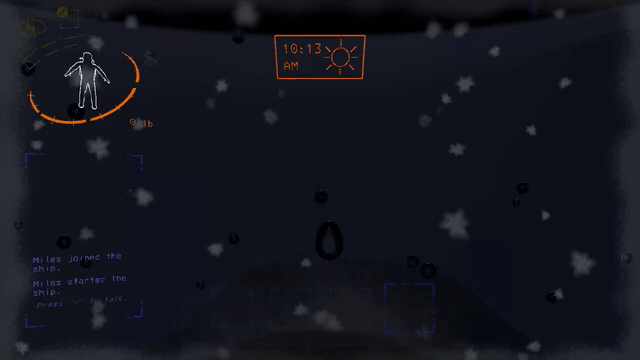
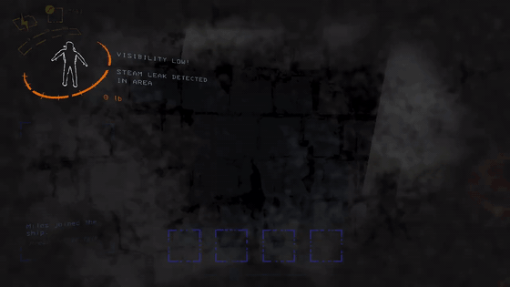
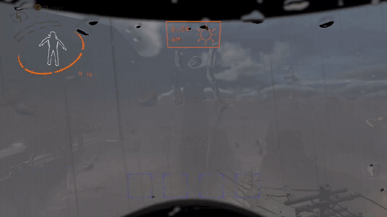
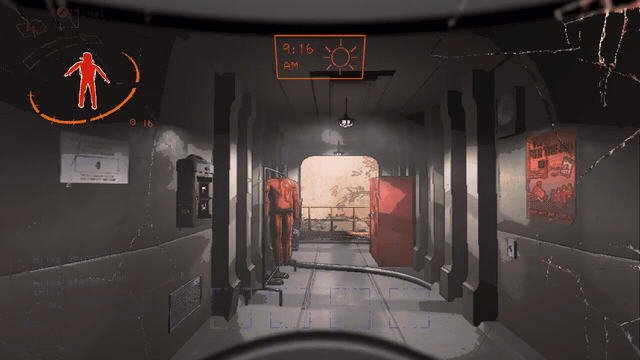
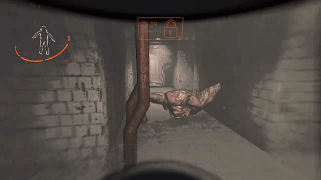

## Immersive Visor Fork
Continuation of [Immersive Visor](https://thunderstore.io/c/lethal-company/p/Woecust/Immersive_Visor/) by **Woecust**, with his permission. All the original effects are his work. This fork adds his two planned features, snow and visor fogging.

This mod aims to create more immersive experience by making the visor reactive to the environment and health.

**Install this instead of the original Immersive Visor, not next to it.** It uses the same config file, so your settings carry over.

Report bugs or incompatibilities on [GitHub](https://github.com/SleepyMiles/ImmersiveVisorFork/issues).

| **Snow (new)** | **Visor Fog (new)** |
|:---:|:---:|
|  |  |
| **Raindrops** | **Screen Crack** |
|  |  |
| **Blood Splatter + Crack** | |
|  | |

# Incompatibility
- Helmet_Camera : Use OpenBodyCams instead.

## Features

# Current Features
- Screen Crack : 2 levels of visor cracking as you take damage.
- Raindrop Effect : Raindrops hitting the visor in rainy, stormy and flooded weather.
- Blood Splatter : Blood on the visor when someone gets hurt near you.
- Snow Effect **(new)** : Snowflakes hit the visor on snowy moons, stay white for a moment, then melt into water drops that slide down.
  - The longer you stay out, the heavier the snow gets, and frost creeps in from the edges of the visor.
  - Random wind gusts throw a few seconds of heavy snow at you.
  - Rain washes the snow and frost away. Going inside lets it melt.
  - Works on Rend, Dine, Titan and modded moons with snow.
- Visor Fog **(new)** : The visor fogs up in foggy weather and next to burst steam valves, then slowly clears from the middle out.
  - Lights glow through the fog.
  - Your breath fogs the bottom of the visor on snowy moons, faster while sprinting.
  - Clears faster inside the ship, slower while sprinting.

Every effect can be turned off or tuned in the config (works with LethalConfig while playing).

## Credits
- **Woecust** : original Immersive Visor (visor rim, cracks, raindrops, blood splatter, all original art and sounds).
- **SleepyMiles** : snow effect, visor fog, fixes and upkeep.
